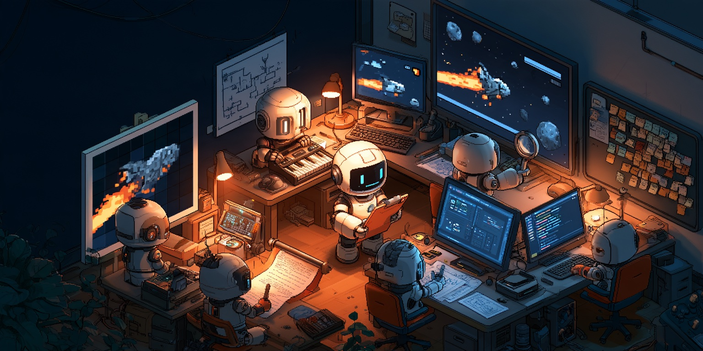
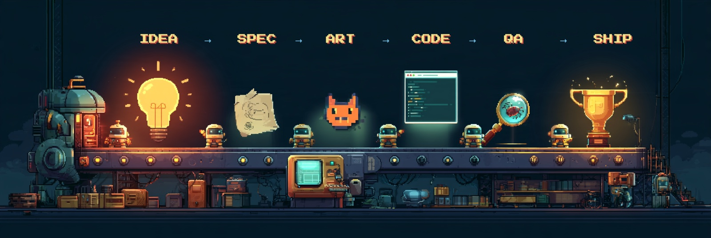
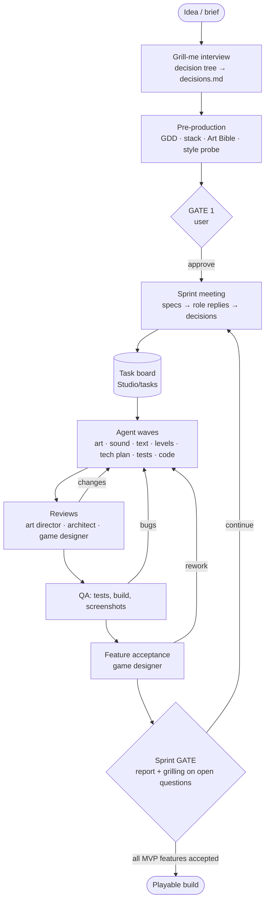
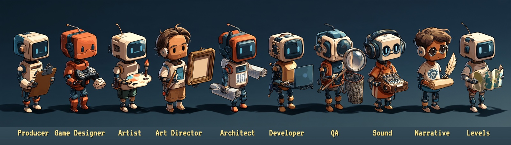

# Indie Game Studio

<p align="center"></p>

A skill for **Claude Code** and **Codex** that runs a team of subagents organized like an
indie studio. The team builds a game in sprints until the features are done.

You bring the idea. The producer grills you in rounds (grill-me style) and records the
decisions. Then the roles work on their own. The game designer writes features and
acceptance criteria. The artist draws sprites and keeps `References/Art TODO.md`; the
art director reviews the art. The architect writes the tech plan, QA writes tests before
the code, the developer implements. The game designer accepts the result. The producer
calls you at kickoff and after every sprint.

The studio works in **your language**. The producer detects it from your first message
and stores it in `Studio/studio.json → language`. Every document, report, review and
gate summary is written in that language. Prompts, templates and tools are in English.

<p align="center"></p>



## The team

<p align="center"></p>

| Role | Does | Checked by |
|---|---|---|
| Producer (the skill, main session) | interview, task board, agent waves, gates | you |
| Game designer | GDD, backlog, feature specs with AC, feature acceptance | you at the gates |
| Artist | mockups, pixel art and SVG, UI, `References/Art TODO.md` | art director |
| Art director | Art Bible, palette, review of art and screenshots (looks at the PNGs) | — |
| Architect | stack, `studio.json`, tech plan with a contract, code review | — |
| Developer | code from the tech plan, asset integration | architect, QA |
| QA | acceptance tests before code, verification, screenshots, bugs | — |
| Sound designer | procedural SFX and chiptune, `References/Audio TODO.md` | game designer |
| Narrative designer | story, dialogue, UI strings | game designer |
| Level designer | ASCII levels → JSON, previews, reachability | game designer |

## How roles hand work over

Roles never talk to each other directly. Everything goes through files in the game
project:

- **The board** — `Studio/tasks/T-NNN.md`. A task has an owner, dependencies, reviewers
  and a handoff log, for example `S1 artist → art-director: hero.png ready for review`.
  Only the producer writes it, through `board.py`.
- **Agent summary** — the lines `STATUS`, `HANDOFF: → role: what`, `NEW TASKS`,
  `QUESTIONS`. The producer moves them onto the board and decides who works next.
- **Meeting** — at the start of a sprint the game designer posts the specs. The other
  roles reply in parallel: what they need, risks, questions, tasks. The game designer
  answers; the producer writes the minutes and the tasks.
- **Personal TODO lists.** The artist keeps `References/Art TODO.md`: what to draw and
  redo from mockups and reviews. The sound designer keeps `References/Audio TODO.md`.

Guarantees:
- every role has its own write zone; after every wave the producer checks it with
  `zones.py verify`, and in Claude Code a hook also blocks writes outside the zone;
- QA's acceptance tests are locked by hashes;
- nobody reviews their own work.

The full contract is [`protocol.md`](plugins/game-studio/skills/game-studio/references/protocol.md).

## Installation

### Claude Code

```
/plugin marketplace add indie-game-studio-ai/indie-game-studio
/plugin install game-studio@indie-game-studio
```

Run it inside the game folder: `/game-studio:game-studio <game idea>`.

### Codex

```sh
git clone https://github.com/indie-game-studio-ai/indie-game-studio.git ~/indie-game-studio
~/indie-game-studio/scripts/install-codex.sh --user            # for all projects
# or
~/indie-game-studio/scripts/install-codex.sh --project ~/my-game
```

The script symlinks the `game-studio` and `grill-me` skills into `.agents/skills/` and the
`studio-*.toml` agents into `.codex/agents/`. Update with `git pull`. Run it in a new Codex
session: `$game-studio <game idea>`.

## Running

```
/game-studio:game-studio A space shooter: a ship dodges asteroids
/game-studio:game-studio brief=docs/brief.md
/game-studio:game-studio brief=docs/brief.md autopilot lean
```

- Without arguments the producer resumes from the step recorded in `Studio/ledger.md`.
- `brief=<file>` — the interview asks only about what the brief does not cover.
- `autopilot` — gates accept the recommendations themselves; blockers and the budget
  cap still stop the work. For unattended runs.
- `lean`, `standard` or `thorough` — the budget profile (see below). Without it, the
  producer asks at kickoff.

## Token economy

A studio of ten roles can burn a lot of tokens. The producer keeps quality where it
matters and cuts repetition everywhere else.

| | lean | standard | thorough |
|---|---|---|---|
| For | prototype, jam, ≤ 3 features | most games | long or risky projects |
| Planning meeting | none | involved roles only | full |
| Reviews | once per feature | batched per wave | every task, fresh reviewer |
| Acceptance tests | written by QA after the code | written by QA before the code | before the code |
| Full test run, build, screenshots | once per sprint | once per sprint | per feature |
| Cap per sprint | 15 agent runs / 3M tokens | 30 / 6M | 60 / 12M |

Tokens are weighted (cache reads at 0.1×, output at 5×, as on the price list) and
include the producer. The caps are a first estimate; `tokens.py report` shows the real
figures after a sprint.

Where the tokens actually go, measured on comparable multi-agent runs: an agent that
inherits the session's tools also inherits the list of all your skills and MCP tools and
re-sends it with every request (42–83% of agent input), and the producer re-sends its
whole context with every bookkeeping call (32–72% of a session). So:

- **Lean agents.** Every agent has an explicit tool list and medium effort. A probe run
  starts at 7.6K tokens instead of 21.9K with inherited tools
  (`scripts/probe_overhead.py` measures it).
- **Context packs.** `board.py pack` puts a run's tasks, AC, its part of the spec and
  the review findings into one file, so the agent does not spend turns collecting them.
- **Two calls per wave.** `waves.py start` and `waves.py finish` do the producer's
  bookkeeping; agents answer in one line and leave the summary in their report.
- **Reuse only when cheaper.** An agent is continued only while its context is small;
  otherwise a fresh agent with a pack costs less.
- **Model per mode, not per role.** Agents default to Sonnet with medium effort. Opus
  only for decisions that drive everything else (spec, tech plan, acceptance), Haiku
  for meeting replies and, in lean, for sound, text and levels. `budget.py routes` shows
  the table.
- **Batches.** One agent run does all ready tasks of a role; a reviewer reviews a whole
  batch at once.
- **No protocol re-reading.** Each role's prompt holds the rules it needs; documents are
  read by section, not whole.
- **Quiet commands.** `quiet.py` keeps test and build logs in a file and shows only the
  status and the error lines.
- **Tests at the end.** The full suite, the build and the screenshots run once in QA's
  verification; the developer runs only its own tests, the architect reviews the diff
  without rerunning them.
- **Budget guard.** `waves.py finish` reads each run's real spend from the Claude Code
  transcripts and `budget.py` checks the cap; over it the producer stops and asks you.
- **Short context.** Size limits for every document and summary. After a sprint gate you
  can `/clear` and continue: the producer resumes from `Studio/ledger.md`.

Tip: the producer mostly does bookkeeping, so run the main session on a mid-size model
(`/model sonnet`, `/effort medium`); roles get the model they need anyway.

## What appears in the game project

```
Studio/      board, producer log, decisions, meetings, reports, reviews, tools
Design/      GDD, backlog, feature specs
References/  Art Bible, palette.json, Art TODO, Audio TODO, mockups
Art/ Audio/ Narrative/ Levels/   asset sources and exports
Tech/        stack, architecture, tech plans
QA/          test plans, bugs, screenshots
```

The game code lives wherever the engine wants it; the architect sets the paths in
`Studio/studio.json`.

## Stack

The studio is not tied to an engine. The architect picks a profile at kickoff:

- **Godot 4** — GUT, headless import, viewport screenshots;
- **Unity** — Test Framework in batchmode, Editor scripts, RenderTexture capture;
- **web-phaser** — Vite + TypeScript + Phaser, Vitest, Playwright;
- **custom** — describe your own engine with the same structure.

The profiles live in [`references/stacks/`](plugins/game-studio/skills/game-studio/references/stacks/).

## Role tools

Plain Python 3 stdlib, nothing to install. They are copied into `Studio/tools/` at start:

| Tool | Purpose |
|---|---|
| `pixelart.py` | palette + ASCII frames → PNG, sprite sheet, atlas, ×N preview, palette check |
| `svg2png.py` | SVG → PNG through whatever renderer is found (resvg, rsvg-convert, inkscape, Chrome) |
| `contact_sheet.py` | a labelled grid of PNGs for review |
| `sfx.py` | procedural SFX (sfxr-like presets) → WAV, peak and clipping analysis |
| `chiptune.py` | text score → looping WAV |
| `level_preview.py` | ASCII level → PNG preview, marker and reachability check, JSON export |
| `board.py` | task board: create, import from minutes, statuses, reviews, batches, context packs, BOARD.md |
| `waves.py` | a wave in two producer calls: start (prompts, packs) and finish (summaries → board) |
| `budget.py` | budget profiles, model routing, spend per sprint and the cap check |
| `tokens.py` | real token spend from Claude Code transcripts: producer, each run, repeated reads |
| `quiet.py` | run a command with the full output in a log and only errors on screen |
| `zones.py` | role write zones, snapshots, test lock, hook |
| `studio_init.py` | lay out templates and tools in the project |

## Limitations

- Art is procedural: pixel art and SVG, no image generation. The Art Bible and the art
  director's reviews keep the style consistent.
- Nobody listens to the sound. It is checked by its parameters and WAV analysis.
- In Codex, write zones rely on instructions and the `zones.py verify` check after each
  wave. The Codex hook does not know which role is writing.
- Token counts come from the platform. Claude Code reports them per agent; Codex does
  not, so there the cap counts agent runs only. The producer's own tokens are not
  counted.

## Developing the studio

- Roles live in `roles/*.md`. `python3 scripts/build.py` generates the agents for Claude
  (`plugins/game-studio/agents/`) and Codex (`codex/agents/`); never edit those by hand.
- Tests: `python3 -m unittest discover -s tests -t .`.
- Rules for agents changing this repository are in [`AGENTS.md`](AGENTS.md).

MIT license. `grill-me` is adapted from the `grilling` skill in
[mattpocock/skills](https://github.com/mattpocock/skills) (MIT); see
[`THIRD_PARTY_NOTICES.md`](THIRD_PARTY_NOTICES.md).
